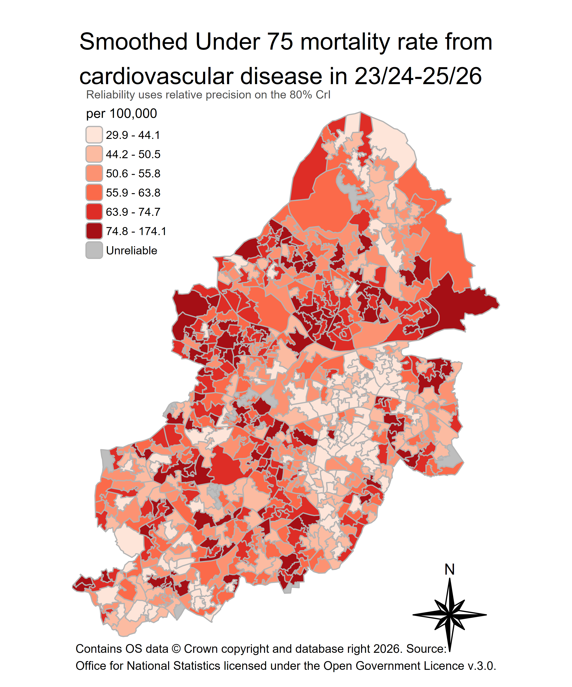
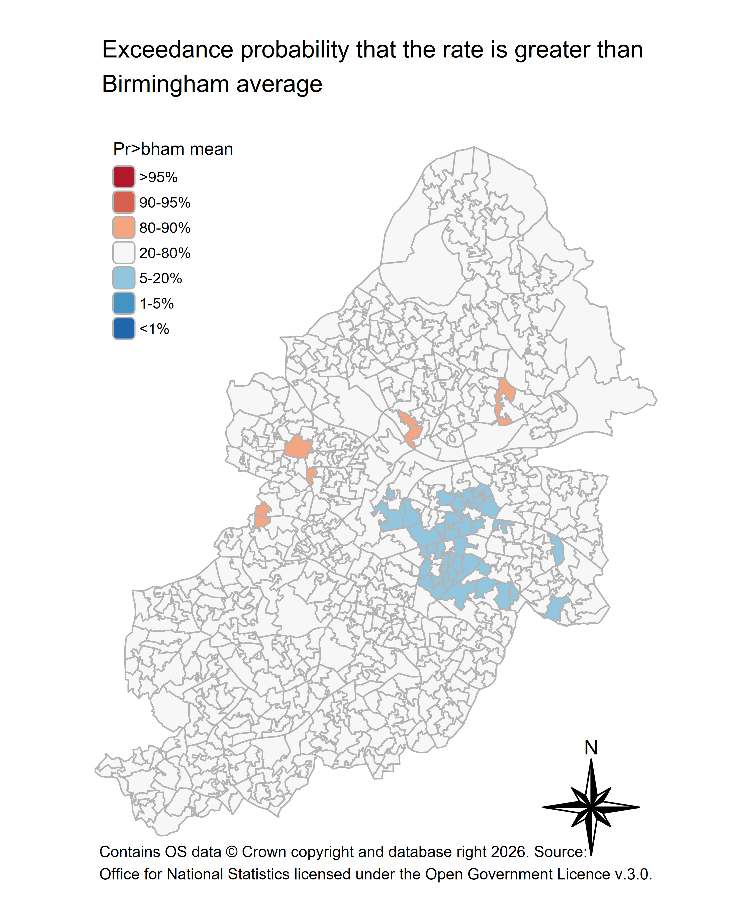

# bccsmooth

Created by: [Chung Au-Yeung](https://github.com/ChungHim5d) </br> Population Health Management</br> Birmingham City Council

### Possible future updates:

-   Smoothing the HES data from BCC SQL server
-   A universal smoothing function for user-supplied counts and denominators, so the package can be used with data from outside the warehouse
-   Prevalence smoothing
-   Spatio-temporal smoothing

## Introduction

### What is bccsmooth?

The bccsmooth is an R package designed to support analysts at Birmingham City Council in producing **small-area health estimates** using Bayesian spatial smoothing models.

The underlying models are built on the Besag-York-Mollié 2 (BYM2) framework implemented via R-INLA, and account for spatial autocorrelation between neighbouring areas. It implies that areas with limited data or even no data borrow strengths from their neighbours rather than relying solely on local counts.

### Development status

**bccsmooth is in early development (version 0.1.0) and is not yet a general-purpose tool.**

At present it supports one workflow for analysts to easily extract death data from BCC SQL server and smooth the rates at either LSOA or Ward level. The current package also produces publication-ready maps.

### Requirements

-   Access to the `PH_Deaths` database with net-motion on
-   ODBC Driver 17 for SQL Server
-   [R-INLA](https://www.r-inla.org/download-install) might need to be installed separately:

``` r
install.packages(
  "INLA",
  repos = c(getOption("repos"), INLA = "https://inla.r-inla-download.org/R/stable"),
  dep  = TRUE,
  type = "binary"
)
```

### How to use?

``` r
# install.packages("devtools")
devtools::install_github("BCC-PHM/bccsmooth")
```

**1. Turn on Net motion (Mobility client)!**

**2. Extract the deaths and build the model inputs.** This connects to the `PH_Deaths` warehouse, so it needs access to the council network. `diagnostic_code` takes ICD-10 patterns, `age` takes a single cut such as `"<75"` or two bounds such as `c("15", "64")`, and `geo_level` is `"lsoa21"` or `"ward"`. If no `geo_level` is supplied, the default extraction will be at LSOA level. The default `financial_year` takes `2025/2026`, to use other financial_year please supply with `YYYY/YYYY` format.

``` r
r = get_ph_deaths(financial_year  = "2025/2026", age = "<75", diagnostic_code = c("I[0-9]%"))
```

**3. Fit the BYM2 model and summarise.** `post_sample` is the number of posterior draws used to build the credible intervals. Use a small number while exploring and at least 1000 as standard requirement for reporting. The smoothing process for LSOA level will take around 10-15 minutes while ward level will take around 1-2 minutes.

``` r
res = smooth_ph_deaths(r, post_sample = 100)
```

**4. Map the smoothed rate.** Areas failing the reliability threshold are drawn as "Suppressed". The default reliability uses 95% CrI when no credible_interval is specified. You can specify a less strict threshold — `"90"` or `"80"` — which lets more areas through:

``` r
map_plot_lsoa = plot_smoothed_map(res,
                  credible_interval = "90",
                  credible_interval_map = FALSE,
                  palette = "brewer.reds",
                  fill_title = "Smoothed Under 75 mortality rate from \ncardiovascular disease in 25/26 Financial Year")
```

If `credible_interval_map = TRUE` is being specified, a list of three maps is returned. Use `$` to extract the one you want. Please use standard `tmap_save` for saving the maps and the following specifications are recommended.

``` r
library(tmap)
tmap_save(map_plot_lsoa,
          "figs/test_map_plot_lsoa.png",
          height = 6,
          width = 5,
          dpi=600)
```



**5. Map the exceedance probability** — the probability that each area's rate is above the Birmingham average.

``` r
test_exceedance_plot = plot_exceedance_prob(res)

tmap_save(test_exceedance_plot,
          "figs/test_exceedance_plot_lsoa.png",
          height = 6,
          width = 5,
          dpi=600)
```



### Reference

The methods implemented in this package draw on:

Moraga, P. (2019). *Geospatial health data: Modeling and visualization with R-INLA and Shiny*. Chapman & Hall/CRC.

Pérez-Panadés, J., Botella-Rocamora, P., & Martinez-Beneito, M. A. (2020). Beyond standardized mortality ratios; some uses of smoothed age-specific mortality rates on small areas studies. *International Journal of Health Geographics, 19*, Article 54. <https://doi.org/10.1186/s12942-020-00251-z>

DeLara, D., Zomorrodi, R., Quick, H., Tootoo, J., Li, R., Baker, J., Kwon, J., Casper, M., & Vaughan, A. (2026). Bayesian Models to Generate Small Area Estimates of Population Health: Tutorial for Using Rate Stabilizing Tools and Their Output. *JMIR Public Health and Surveillance, 12*, Article e83498. <https://doi.org/10.2196/83498>
