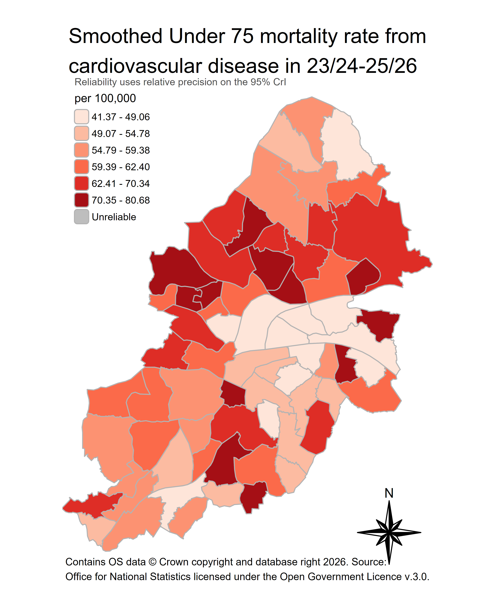
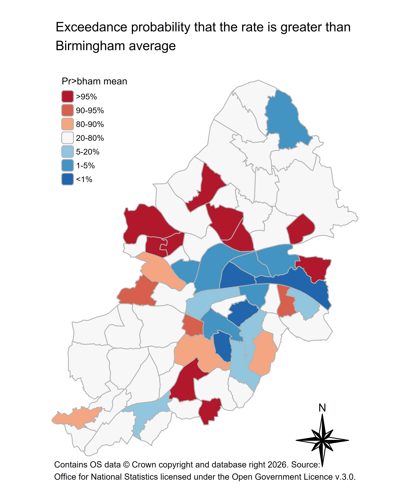

# bccsmooth

Created by: [Chung Au-Yeung](https://github.com/ChungHim5d) </br> Population Health Management</br> Birmingham City Council

### What's new in 0.1.4 (27/10/2026)

- **Age-space-time model:** new `smooth_ph_rates_st()` fits the Goicoa et al. (2016) age-space-time model (Leroux spatial term, RW1 age and time, space-age, space-time and age-time interactions). This model now only works on data extracted from `get_ph_deaths()` and it is recommended to use data from 2001/02 to 2025/26 at ward level for age-space-time modelling.

- **Age bands:** `get_ph_deaths()` gains an `age_bands` argument with presets `"5yr"` (default), `"10yr"`, `"under40_merged"` and `"under20_over65_merged"`, and now also returns `inla_dat_st` (one row per area, age band and year) for `smooth_ph_rates_st()`.

- **Mapping the temporal output:** `plot_smoothed_map()` and `plot_exceedance_prob()` accept output from `smooth_ph_rates_st()` and facet the map by financial year.

- **Zero population:** in both smoothing functions, area-age cells with a population of zero are given 1, so the model can still estimate a smoothed rate for them (following Smith et al., 2025).

#### Bug fixes

- **Character age:** `get_ph_deaths()` received age from the warehouse as text, so age bands were assigned by comparing text rather than numbers (for example, "9" counts as greater than "75" when compared as text). Deaths could therefore land in the wrong age band. Age is now converted to a number before banding.

- **Infant deaths:** `get_ph_deaths()` built age bands from `AGE`, which records age in months for deaths under one year. Infant deaths were therefore placed in the 1-4, 5-9 or 10-14 bands instead of "UNDER 1". Age bands are now built from `AgeInYears`, which correctly distribute infant deaths.

### What's new in 0.1.3 (20/10/2026)

- **Hospital admissions:** new `get_ph_hes()` extracts inpatient admissions from the `PH_HES`, with similar arguments and output structure as `get_ph_deaths()`.
- **Renamed:** `smooth_ph_deaths()` is now `smooth_ph_rates()`, as it smooths both deaths and admissions.
- **Output column:** `final_result` now has `local_death` or `local_admission`, depending on the source.

### Possible future updates:

- A universal smoothing function for user-supplied counts and denominators, so the package can be used with data from outside the warehouse
- Prevalence smoothing

## Introduction

### What is bccsmooth?

The bccsmooth is an R package designed to support analysts at Birmingham City Council in producing **small-area health estimates** using Bayesian spatial smoothing models.

The underlying models are built on the Besag-York-Mollié 2 (BYM2) framework implemented via R-INLA, and account for spatial autocorrelation between neighbouring areas. It implies that areas with limited data or even no data borrow strengths from their neighbours rather than relying solely on local counts.

### Development status

**bccsmooth is in early development (version 0.1.3) and is not yet a general-purpose tool.**

At present it supports two workflows for analysts to easily extract death and inpatient data from BCC SQL server and smooth the rates at either LSOA or Ward level. The current package also produces publication-ready maps.

### Requirements

- Access to the `PH_Deaths` database with net-motion on
- ODBC Driver 17 for SQL Server
- [R-INLA](https://www.r-inla.org/download-install) might need to be installed separately:

``` r
install.packages(
  "INLA",
  repos = c(getOption("repos"), INLA = "https://inla.r-inla-download.org/R/stable"),
  dep  = TRUE,
  type = "binary"
)
```

### How to use?

``` r
# install.packages("devtools")
devtools::install_github("BCC-PHM/bccsmooth")
```

**1. Turn on Net motion (Mobility client)!**

**2. Extract the deaths and build the model inputs.** This connects to the `PH_Deaths` warehouse, so it needs access to the council network. `diagnostic_code` takes ICD-10 patterns, `age` takes a single cut such as `"<75"` or two bounds such as `c("15", "64")`, and `geo_level` is `"lsoa21"` or `"ward"`. If no `geo_level` is supplied, the default extraction will be at LSOA level. The default `financial_year` takes `2025/2026`, to use other financial_year please supply with `YYYY/YYYY` format. Multiple financial years can also be specified and the final result will be a N-year pooled rate.

``` r
wardr = get_ph_deaths(age = "<75", diagnostic_code = c("I[0-9]%"),
                  financial_year = c("2025/2026", "2024/2025", "2023/2024"),
                  geo_level = "ward")
                  
```

**3. Fit the BYM2 model and summarise.** `post_sample` is the number of posterior draws used to build the credible intervals. Use at least 1000 as standard requirement for reporting. The smoothing process for LSOA level will take around 10-15 minutes while ward level will take around 1-2 minutes.

``` r
res = smooth_ph_rates(wardr , post_sample = 1000)
```

**4. Map the smoothed rate.** Areas failing the reliability threshold are drawn as "Unreliable". The default reliability uses 95% CrI when no credible_interval is specified. You can specify a less strict threshold — `"90"` or `"80"` — which lets more areas through. **If a lot of the areas are still suppressed when using LSOA level, you might want to try pooling multiple years or using ward level smoothing**.

``` r
map_plot_ward = plot_smoothed_map(res,
                                  credible_interval = "95",
                                  credible_interval_map = FALSE,
                                  palette = "brewer.reds",
                                  fill_title = "Smoothed Under 75 mortality rate from \ncardiovascular disease in 23/24-25/26 Financial Year")
```

If `credible_interval_map = TRUE` is being specified, a list of three maps is returned. Use `$` to extract the one you want. Please use standard `tmap_save` for saving the maps and the following specifications are recommended.

``` r
library(tmap)
tmap_save(map_plot_ward,
          "figs/test_map_plot_ward.png",
          height = 6,
          width = 5,
          dpi=600)
```



**5. Map the exceedance probability** — the probability that each area's rate is above the Birmingham average.

``` r

test_exceedance_prob_map_plot = plot_exceedance_prob(res)


tmap_save(test_exceedance_prob_map_plot,
          "figs/test_exceedance_prob_map_plot.png",
          height = 6,
          width = 5,
          dpi=600)
```



**6. Extract and smooth HES inpatient admissions.** `get_ph_hes()` connects to the `PH_HES` warehouse, so it also needs access to the council network. `age`, `geo_level` and `financial_year` work exactly as in step 2. HES data are available from 2016/2017 onwards; if a requested year is missing, the function stops and lists the years that are available.

`primary_diagnostic_code` takes ICD-10 patterns matched against the primary diagnosis. Some Fingertips indicators count an admission when the code appears in **any** diagnosis position, please set `secondary_diagnostic_code = TRUE` so all 20 diagnosis positions are checked.

To match fingertips indicators closely, the default filters are:

| Argument | Default | Meaning |
|------------------------|------------------------|------------------------|
| `primary_diagnostic_code` | `NULL` | ICD-10 patterns; `NULL` returns all causes |
| `secondary_diagnostic_code` | `FALSE` | `FALSE` checks the primary diagnosis only; `TRUE` checks all 20 diagnosis positions |
| `epistat` | `"3"` | Finished episodes |
| `epiorder` | `"1"` | First episode of each spell, so each admission is counted once |
| `sex` | `c("1", "2")` | Only includes valid sex |
| `classpat` | `c("1", "2")` | Ordinary admissions and day cases; excludes regular day and night attenders |
| `resladst_ons` | `"E08000025"` | Birmingham residents |

``` r
hes_ward = get_ph_hes(primary_diagnostic_code = c("K70%"),
                      age = "<75",
                      financial_year = "2025/2026",
                      geo_level = "ward")

res_hes = smooth_ph_rates(hes_ward, post_sample = 1000)
```

The result can be passed to `plot_smoothed_map()` and `plot_exceedance_prob()` exactly as in steps 4 and 5.

### References

The methods implemented in this package draw on:

DeLara, D., Zomorrodi, R., Quick, H., Tootoo, J., Li, R., Baker, J., Kwon, J., Casper, M., & Vaughan, A. (2026). Bayesian models to generate small area estimates of population health: Tutorial for using rate stabilizing tools and their output. *JMIR Public Health and Surveillance, 12*, Article e83498. <https://doi.org/10.2196/83498>

Ellis, D. (2024). *BSol.mapR* [R package]. GitHub. <https://github.com/BBCS-PHI/BSol.mapR>

Goicoa, T., Ugarte, M. D., Etxeberria, J., & Militino, A. F. (2016). Age–space–time CAR models in Bayesian disease mapping. *Statistics in Medicine, 35*(14), 2391–2405. <https://doi.org/10.1002/sim.6873>

Moraga, P. (2019). *Geospatial health data: Modeling and visualization with R-INLA and Shiny*. Chapman & Hall/CRC.

Pérez-Panadés, J., Botella-Rocamora, P., & Martinez-Beneito, M. A. (2020). Beyond standardized mortality ratios; some uses of smoothed age-specific mortality rates on small areas studies. *International Journal of Health Geographics, 19*, Article 54. <https://doi.org/10.1186/s12942-020-00251-z>

Smith, M. J., Roberts, E. K., Charlton, M. E., & Oleson, J. J. (2025). Incorporating small-area estimation into mediation analyses with areal datasets. *Spatial and Spatio-temporal Epidemiology, 54*, 100735. <https://doi.org/10.1016/j.sste.2025.100735>
